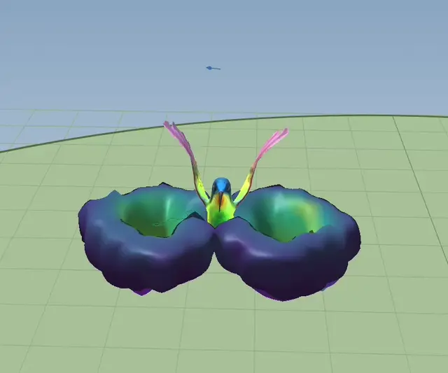
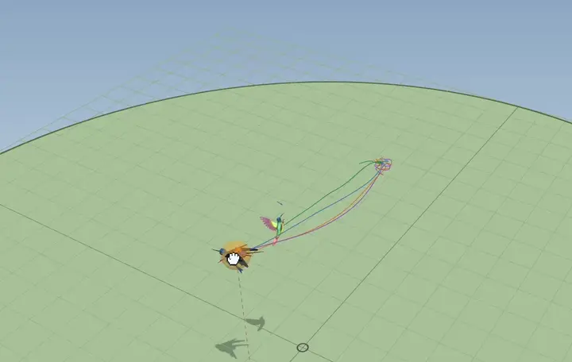
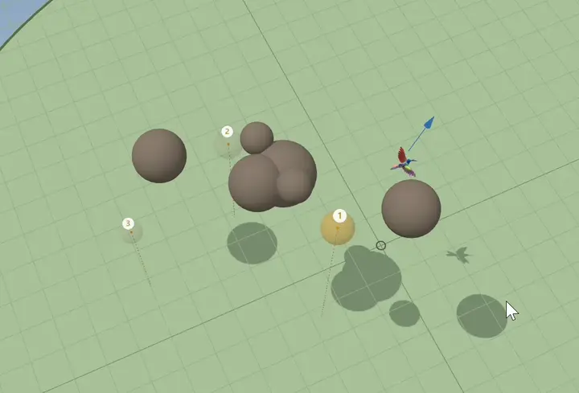

# Hummingbird RL

A simulated hummingbird, unstable in hover and flying in gusty air, controlled by three deep reinforcement
learning algorithms (PPO, SAC, TD3 with Stable-Baselines3) and by two classical controllers (a cascaded PID
and an LQR), on four tasks of increasing difficulty: hover and recover, go to a point, fly around obstacles,
follow a course.

<p align="center">
  
  <br>
  <em>The bird and the air its wings push down, simulated live in the browser: vortex tubes, then a laser sheet.</em>
</p>

**[Interactive demo](https://nca1431.github.io/hummingbird-rl/)** (every controller flies live in your
browser) · **[W&B report](https://forge.coreweave.com/wandb/nca1431-centralesup-lec/hummingbird-rl/reports/Teaching-a-simulated-hummingbird-to-fly-deep-RL-against-classical-control--VmlldzoxODE3NDkwOA)** (the results, with interactive charts) ·
**[The algorithms explained (PDF)](docs/algorithms_report.pdf)** (from PID and LQR to PPO, TD3 and SAC)

*I chose this problem, defined the tasks and the experiments, ran all 124 training runs and the evaluations
on my own computer, and interpreted the results. I used Claude (Anthropic) as a tool to write most of the
code and to draft the text, which I reviewed and corrected. [How this project was built](#how-this-project-was-built)
says how the work was shared.*

## Key findings

- **Classical control is hard to beat in calm air.** PID and LQR succeed in 100% of the hover and
  go-to-point tests. Under wind and wing damage, the PID, thanks to its integrators, stays the most robust
  controller on hover (robust area 0.82 out of 1). On go-to-point, only agents trained in randomised
  conditions beat it (PPO 0.96 against 0.81).
- **Learning pays off where planning matters.** Around obstacles SAC succeeds in 98% and PPO in 89% of the
  episodes, against 44 to 52% for the classical controllers. On the long navigation course the cautious PID
  stays best (41%, PPO 18%, 27% with transfer).
- **Train in randomised conditions.** Trained in calm air, every learned policy loses to the PID under wind
  (robust area 0.08 to 0.39). Trained with random wind, mass and wing damage, PPO reaches 0.96 on
  go-to-point, and after a sudden 40% wing failure it deviates by 1.5 cm, against 9.1 cm for the PID.
- **PPO is the most reliable learner; SAC and TD3 the most sample-efficient but unstable:** their success
  swings during training (SAC ends at 64%, its best checkpoint scored 99%).

124 training runs (181 million environment steps, about 200 CPU-hours on one laptop), 122 controllers
evaluated on about 78,000 held-out episodes, a simulator with 144 tests, and a browser port of it that
reproduces the Python results to 4·10⁻¹² (124 more tests).

## Setup (Windows, PowerShell, with uv)

```powershell
git clone https://github.com/NCA1431/hummingbird-rl
cd hummingbird-rl
uv sync                 # creates .venv with Python 3.12, installs PyTorch (CUDA) and everything else
uv run python -c "import torch; print(torch.__version__, torch.cuda.is_available(), torch.cuda.get_device_name(0))"
uv run pytest           # 144 passed
uv run wandb login      # once, only to log to Weights & Biases (the key is kept by wandb, never in the code)
```

`uv.lock` pins every version. pandas is kept below 3.1: on Windows with Smart App Control on, its newer
builds were blocked as unsigned code.

## Layout

```
hummingbird_rl/
  sim/      the bird: parameters, rotations, aerodynamics, wind gusts, rigid-body dynamics
  world/    scenes (targets and obstacles), collisions, random scene generation
  tasks/    hover & recover, go-to-point, obstacles, navigation: rewards and success rules
  envs/     the Gymnasium environment, the observation, the disturbance regimes
  controllers/  classical baselines: PID and LQR, with a potential field for obstacles; action mixer
  training/     train.py (PPO, SAC, TD3 with Stable-Baselines3), logging callbacks
  evaluation/   episodes on fixed seeds; suites (test, robustness grid, mass, failure, behaviour); intervals
  analysis/     the learned critic and policy compared with the LQR (E6)
  export/       recorded episodes, policy networks and golden test files for the web viewer
configs/algos/        hyperparameters of each algorithm
configs/experiments/  lists of runs for scripts/launch.py
scripts/    training batches, evaluation, tables, figures, W&B logging and report, export to the web viewer
docs/       the W&B report's text, the algorithms report (Markdown and PDF), the custom W&B charts
tests/      one test file per module
web/        the web viewer: Vite + TypeScript + three.js, with a TypeScript port of the simulator
data/vanderbilt/  hummingbird wing kinematics (Song et al. 2016, Dryad doi:10.5061/dryad.8ch1b),
                  extracted from the dataset's MATLAB figures by scripts/extract_dryad.py
```

## Training

```powershell
uv run python -m hummingbird_rl.training.train --algo ppo --task hover --steps 1e6 --wandb
uv run python scripts/launch.py configs/experiments/pilots.yaml --parallel 7     # a batch of runs
uv run python scripts/runs_summary.py                                           # one line per run
```

Runs are saved in `results/runs/<algo>_<task>_<regime>_s<seed>_<date>_<time>/`.

## Evaluation and reports

```powershell
uv run python scripts/evaluate.py --policy pid --tasks hover goto obstacles navigation
uv run python scripts/evaluate.py --policy ppo_goto_randomised_s1 --suites test grid mass failure
uv run python scripts/eval_summary.py          # every result, one table per task
uv run python scripts/export_curves.py         # learning curves, from the TensorBoard logs
uv run python scripts/make_figures.py          # the figures of the PDF
uv run python scripts/interpret.py             # E6: PPO's critic against the LQR
uv run python scripts/log_results_wandb.py     # the results, as W&B data, for the report's charts
uv run python scripts/make_report_wandb.py --url <report link>   # rebuild the W&B report from docs/wandb_report.md
```

Every controller faces the same held-out episodes, in the same order. The PDF is built with pandoc and
xelatex (the command is at the top of `docs/algorithms_report.md`).

## Web viewer

Needs Node.js (LTS). Four modes. **Recorded** replays test episodes exactly as they were measured. **Live**
flies new random episodes in the browser: the simulator, the tasks, the PID, the LQR and the trained
networks are ported to TypeScript and checked against the Python code on recorded inputs and outputs
(`web/tests/golden/`): whole PID and LQR episodes agree to 1e-9 m, the networks to 1e-5. The **Sandbox**
lets you place the targets and obstacles and set the wind, mass and wing damage yourself, and fly up to four
controllers in exactly the same situation. In **Play** the birds fly without end while you drag the target
and the obstacles, or let the target follow the mouse; you can hide the target from the birds to see what
each controller does without a goal. The air around the bird is a real-time fluid simulation, shown as
smoke, a laser sheet or vortex tubes. The Legend lists the keys and gestures.

<p align="center">
  
  <br>
  <em>Play: the PID, the LQR and two PPO agents chase a target dragged with the mouse; a bird that falls starts again.</em>
</p>

<p align="center">
  
  <br>
  <em>Sandbox: the PID and SAC on a navigation course, in a wind of 25% of the bird's weight, with the left wing weakened by 30%.</em>
</p>

```powershell
uv run python scripts/export_web.py episodes --policy pid --tasks hover goto obstacles navigation
uv run python scripts/export_web.py policy --policy ppo_goto_normal_s1        # a network, for Live, Sandbox and Play
cd web
npm ci                  # once, and after any change to package-lock.json
npm test                # parity of the TypeScript simulator with the Python one, and the viewer's logic
npm run dev             # local server, open the address it prints
```

The site is published on GitHub Pages by `.github/workflows/deploy-web.yml` at every push that changes `web/`.

## How this project was built

Hummingbirds fascinate me: they are beautiful, their flight is both graceful and remarkably precise, and
they are the only birds that can hover for long, fly backwards and turn on the spot. I wanted to learn
reinforcement learning on a problem I cared about. I defined the tasks, the experiments and the
comparisons, chose between the options at each step, ran every training and evaluation on my own computer
and interpreted the results. I used Claude (Anthropic) to write most of the code (the simulator, the
training and evaluation pipeline, the web demo) and to draft the text of both reports from my results,
which I reviewed, questioned and corrected. I studied the simulator, the tasks, the classical controllers
and the learning algorithms closely, and the training setup, the configurations, the evaluation suites, the
analysis and the tests in less depth. The rest (the export to the browser, the scripts and the web demo) I
checked from the outside: what each part takes in, what it returns and why.

This is my second version of the project. During the summer holidays I spent three weeks on a first
hummingbird simulation, also built with AI assistance, set in a much more complex world and with a large
part written in C++. It grew too large to finish, so I started again, smaller, in Python, with classical
baselines from the start. The end of the [W&B report](https://forge.coreweave.com/wandb/nca1431-centralesup-lec/hummingbird-rl/reports/Teaching-a-simulated-hummingbird-to-fly-deep-RL-against-classical-control--VmlldzoxODE3NDkwOA) says more about that first attempt,
what I learned and what I would do differently.

## Credits

- Wing kinematics: Song, Tobalske, Powers, Hedrick & Luo (2016), *R. Soc. Open Sci.* 3:160230,
  Dryad doi:10.5061/dryad.8ch1b.
- 3D hummingbird in the viewer: ["Animated Hovering Flying Hummingbird Loop"](https://sketchfab.com/3d-models/animated-hovering-flying-hummingbird-loop-102884713a2742ce829e368d2a790c45)
  by LasquetiSpice, licensed under [CC BY 4.0](https://creativecommons.org/licenses/by/4.0/). Changes: textures
  resized and converted to WebP, unused animation and keyframes removed (`web/tools/shrink-model.mjs`), rendered
  with our own shader (`web/src/view/feathers.ts`); its root motion is ignored and its wingbeat replayed at the
  simulated frequency.
- Built with Stable-Baselines3, Gymnasium, PyTorch, Weights & Biases, three.js and Vite.

## License

MIT (see `LICENSE`). The 3D model keeps its own licence, CC BY 4.0.
